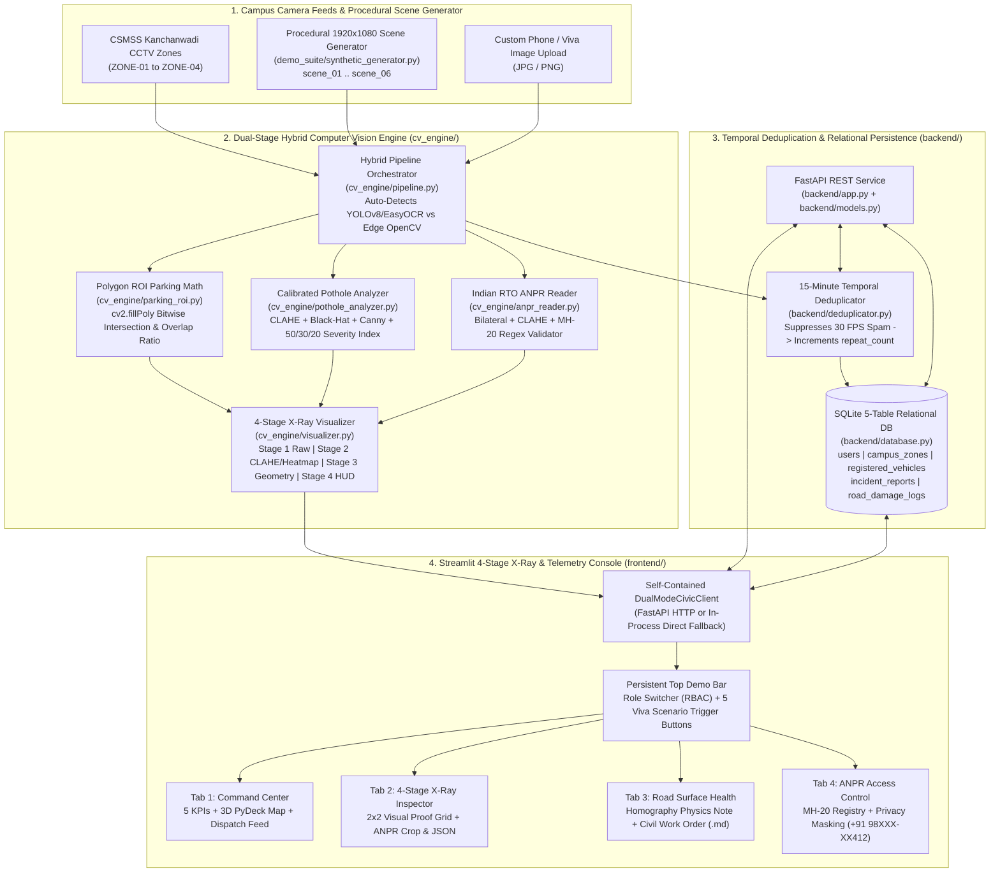
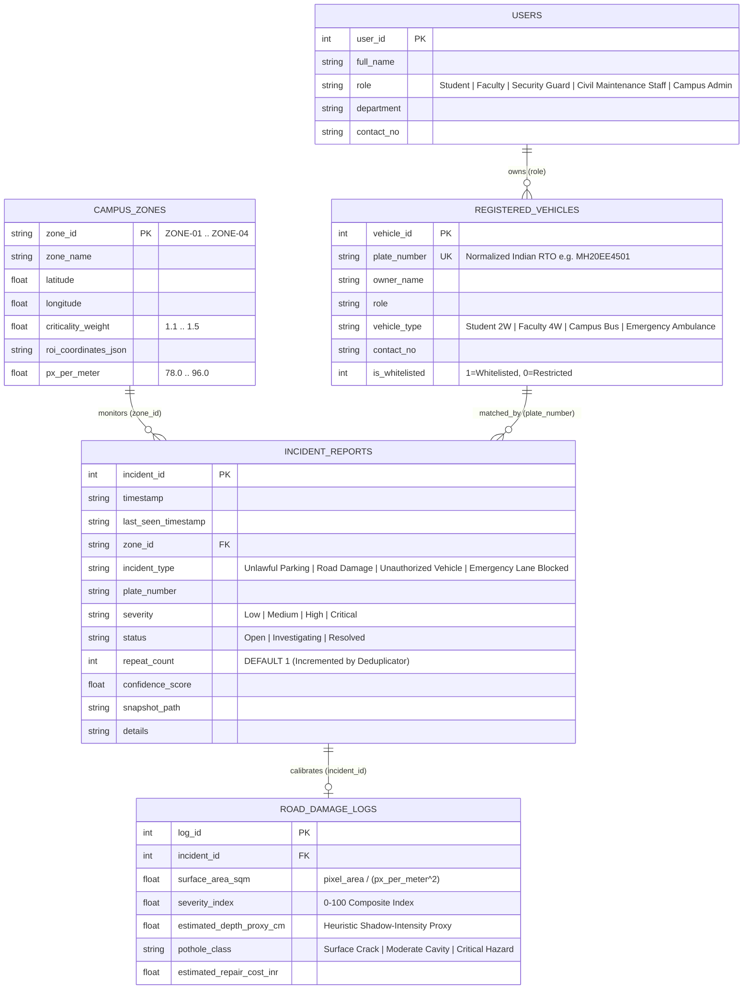

# CSMSS Kanchanwadi Civic Monitor v2.0

**Explainable Edge Computer Vision, Indian RTO (`MH 20`) ANPR, Homography-Calibrated Road Damage Grading & Temporal Incident Deduplication Platform**

- **Institution:** CSMSS Chh. Shahu College of Engineering, Kanchanwadi, Paithan Road, Chhatrapati Sambhajinagar (Aurangabad), Maharashtra — 431011
- **Academic Track:** Community Involved Project (**CIP — 150 Marks Demonstration & Viva Release**)
- **CampusGeospatial Anchor:** `19.8260° N, 75.2950° E` (CSMSS Kanchanwadi Campus Corridor)
- **System Version:** `v2.0.0` (Dual-Stage Hybrid CV Engine + 4-Stage Visual X-Ray Console + 15-Minute Temporal Deduplicator)

## 1. Project Overview & Campus Civic Problem Statement

Modern engineering campuses face three recurring civic infrastructure and safety challenges that manual security patrols struggle to log and prioritize systematically:

1. **Emergency & Pedestrian Corridor Obstructions:** Two-wheelers and unauthorized four-wheelers parked inside the **Main Gate & Security Plaza (`ZONE-01`)** ambulance bay or **Central Library Approach Road (`ZONE-03`)** silent pedestrian walkways delay emergency medical response and obstruct student movement.
2. **Monsoon Asphalt Ravelling & Pothole Hazards:** Heavy monsoon runoff along Paithan Road and bus turning shear at **Diploma Building Circle (`ZONE-02`)** create waterlogged potholes that pose skidding hazards for student two-wheelers and require quantified civil maintenance work orders (damaged surface area in $m^2$, severity index $0\text{--}100$, and estimated patch cost in INR).
3. **Unverified Commercial & Visitor Vehicle Entry:** External commercial vehicles entering restricted zones such as the **Mechanical Workshop Bay (`ZONE-04`)** without a valid campus gate pass require automated **Maharashtra (`MH 20` Chhatrapati Sambhajinagar)** license plate recognition cross-checked against a privacy-aware campus vehicle registry.

**CSMSS Kanchanwadi Civic Monitor v2.0** solves these three problems in a single, self-contained software stack that runs **100% deterministically on any standard college lab CPU (`~142 ms/frame`)** while automatically upgrading to **YOLOv8 + EasyOCR** when deep-learning weights are installed.

### Monitored CSMSS Kanchanwadi Campus Zones

| Zone ID | Campus Corridor Name | GPS Coordinates (`Lat, Lon`) | Criticality Weight ($w_{\text{zone}}$) | Homography Scale ($k_{\text{zone}}$) | Primary Civic Monitoring Focus |
| :--- | :--- | :--- | :-: | :-: | :--- |
| **`ZONE-01`** | Main Gate & Security Plaza | `19.8268, 75.2951` | `1.5` | `92.0 px/m` | Emergency ambulance apron clearance & Paithan Road entry checkpost |
| **`ZONE-02`** | Diploma Building Circle | `19.8262, 75.2944` | `1.3` | `84.5 px/m` | High-density student rotary, bus drop-off junction & monsoon pothole grading |
| **`ZONE-03`** | Central Library Approach Road | `19.8256, 75.2958` | `1.2` | `78.0 px/m` | Silent academic spine no-parking enforcement & longitudinal asphalt crack tracking |
| **`ZONE-04`** | Mechanical Workshop Bay | `19.8251, 75.2949` | `1.1` | `96.0 px/m` | Heavy lab equipment loading bay & unauthorized commercial vehicle detection |

## 2. System Architecture Diagram (Mermaid.js)



### 5-Table Relational Database Schema (`backend/database.py`)



## 3. Key Engineering Highlights

### 3.1 Explainable 4-Stage Computer Vision X-Ray Pipeline (`cv_engine/visualizer.py`)
Rather than acting as an opaque black box, every analyzed frame produces **4 synchronized RGB `np.ndarray` visual stages** displayed in a 2×2 grid inside **Tab 2 (4-Stage CV X-Ray Inspector)**:
- **Stage 1 (`stage1_raw`):** Original camera input frame stamped with the IST timestamp and CSMSS Kanchanwadi zone banner.
- **Stage 2 (`stage2_preprocessed`):** Grayscale + Gaussian smoothing + **CLAHE** (`clipLimit=2.5`) + **25×25 Elliptical Morphological Black-Hat** + **Canny Edge** & **Turbo Anomaly Heatmap** overlay showing the exact luminance depressions and edge gradients seen by the algorithm.
- **Stage 3 (`stage3_geometry`):** Semi-transparent restricted **ROI Polygon** (`cv2.fillPoly`) + crimson bitwise **Vehicle Footprint Intersection Mask** (`overlap_ratio = intersection_area / vehicle_box_area`) + **Pothole Contour Crosshair Mesh**.
- **Stage 4 (`stage4_hud`):** Final tactical HUD frame with corner-bracket bounding boxes, `[MH 20 ...]` callout badges, a live `0–100` Severity Index meter bar, per-stage latency telemetry (`Pre`, `Det`, `ANPR`, `Total`), and GPS watermarks.

### 3.2 Homography-Calibrated Road Damage Severity Index ($0\text{--}100$) vs. 2D Depth Heuristics
A single 2D monocular CCTV camera cannot directly measure true 3D millimeter depth without stereo disparity or LiDAR. Our pipeline addresses this with strict scientific transparency:
1. **Perspective Homography Surface Area ($m^2$):** Converts contour pixel area $A_{\text{pixels}}$ into physical square meters using each zone's calibrated road-plane scale factor $k_{\text{zone}}$ (`px_per_meter`):
   $$A_{\text{sqm}} = \frac{A_{\text{pixels}}}{\left(k_{\text{zone}}\right)^2}$$
2. **Composite Road Damage Severity Index ($0\text{--}100$):** Combines three normalized, measurable quantities:
   $$\text{SI}_{0\text{--}100} = 100 \times \Big(0.50\,\hat{A}_{\text{area}} + 0.30\,\hat{D}_{\text{shadow}} + 0.20\,\hat{J}_{\text{jaggedness}}\Big)$$
   where $\hat{A}_{\text{area}} = \min(1.0, A_{\text{sqm}} / 1.45)$ weights physical footprint (**50%**), $\hat{D}_{\text{shadow}}$ measures the relative HSV $V$-channel luminance drop inside the cavity versus surrounding asphalt (**30%**), and $\hat{J}_{\text{jaggedness}}$ measures perimeter-to-area fracture complexity $P^2 / (4\pi A_{\text{pixels}})$ (**20%**).
3. **Explicitly Labeled Depth Proxy & Repair Cost Estimation:** `estimated_depth_proxy_cm` is explicitly labeled across the database, API, and UI as a **`Heuristic Shadow-Intensity Proxy (Monocular CV)`**, while civil repair cost in INR is computed via:
   $$\text{Cost}_{\text{INR}} = \text{INR } 450 + A_{\text{sqm}} \times \text{INR } 1850 \times \left(1 + 0.85 \cdot \frac{\text{SI}}{100}\right) \times w_{\text{zone}}$$

### 3.3 15-Minute Temporal Incident Deduplication (`backend/deduplicator.py`)
On a live camera stream, a stationary car blocking the Main Gate or a pothole at Diploma Circle is detected in every single frame. Instead of flooding SQLite with thousands of duplicate rows:
- When a new incident arrives, `record_or_deduplicate_incident()` queries `incident_reports` for an active (`Open` or `Investigating`) record in the same `zone_id` and `incident_type` with the same normalized `plate_number` (or `pothole_class`) whose `last_seen_timestamp` is within `DEDUP_WINDOW_MINUTES` (default **15 minutes**).
- If matched, it increments `repeat_count = repeat_count + 1`, updates `last_seen_timestamp`, retains the maximum `confidence_score` and escalated `severity`, and returns `{"deduplicated": True, "incident_id": existing_id, "repeat_count": new_count}`.

### 3.4 Role-Based Privacy Masking & Self-Contained Dual-Mode Execution
- **Privacy-by-Design RBAC (`View As` Switcher):** Switching the top bar to **`Student / Public Kiosk (Privacy Masked)`** automatically masks personal phone numbers into `+91 98XXX-XX412` or `[REDACTED]` and disables incident status mutation controls, whereas **`Campus Director / Examiner`** and **`Security Control Room`** have full unmasked access and dispatch authority.
- **Zero-Crash Dual-Mode Architecture (`DualModeCivicClient`):** `frontend/dashboard.py` automatically connects to FastAPI (`http://127.0.0.1:8000`) when running, or seamlessly falls back to in-process calls to `backend.database`, `backend.deduplicator`, and `cv_engine.pipeline` if only Streamlit is launched.

## 4. Repository Structure

```text
csmss-kanchanwadi-civic-monitor/
├── requirements.txt                  # Core dependencies + optional YOLOv8/EasyOCR hybrid notes
├── README.md                         # Architecture docs, quickstart & Viva Defense Guide
├── config/
│   ├── __init__.py
│   └── settings.py                   # 4 CSMSS Kanchanwadi zones, ROI polygons, px/m scales & UI tokens
├── backend/
│   ├── __init__.py
│   ├── models.py                     # Pydantic v2/v1 compatible domain models & Indian RTO validators
│   ├── database.py                   # 5-table SQLite WAL schema, FK enforcement & analytical queries
│   ├── deduplicator.py               # 15-minute temporal deduplication engine (repeat_count increment)
│   └── app.py                        # FastAPI service (/health, /analytics/summary, /zones, /incidents, /demo)
├── cv_engine/
│   ├── __init__.py
│   ├── parking_roi.py                # Bitwise cv2.fillPoly ROI mask & overlap_ratio geometry
│   ├── pothole_analyzer.py           # CLAHE + Black-Hat + Canny + 50/30/20 Severity Index & INR cost
│   ├── anpr_reader.py                # Bilateral + CLAHE plate crop & Indian RTO (MH 20) regex validator
│   ├── visualizer.py                 # 4-Stage RGB X-Ray frame renderer (Raw, Preprocessed, Geometry, HUD)
│   └── pipeline.py                   # Dual-Stage Hybrid CV orchestrator + per-stage latency telemetry
├── demo_suite/
│   ├── __init__.py
│   ├── synthetic_generator.py        # Generates 6 1920x1080 procedural campus scenes & seeds rich DB
│   └── run_verification.py           # 10-Stage Automated Verification Suite with terminal scorecard
└── frontend/
    ├── __init__.py
    ├── styles.py                     # Custom dark tactical CSS, KPI cards & RBAC phone masking helper
    ├── dashboard.py                  # Main Streamlit app, DualModeCivicClient, Top Viva Bar & Sidebar
    └── views/
        ├── __init__.py
        ├── command_center.py         # Tab 1: 5 KPIs, 3D PyDeck Map (with 2D fallback) & Dispatch Feed
        ├── xray_inspector.py         # Tab 2: 4-Stage Visual Pipeline Grid, ANPR Crop & Raw JSON
        ├── road_health.py            # Tab 3: Homography Physics Note, Zone Scorecard & Work Order (.md)
        └── access_control.py         # Tab 4: Searchable MH-20 Registry, Privacy Masking & Registration Form
```

## 5. 1-Command Quickstart & Live Demo Instructions

### Step 1 — Install Dependencies
```bash
pip install -r requirements.txt
```

### Step 2 — Run the 10-Stage Automated Verification Suite & Generate Demo Assets
This single command generates all **6 high-realism `1920×1080` test frames** in `data/demo_frames/`, seeds `data/csmss_civic.db` with **10 users, 12 `MH 20` vehicles, 15 historical incidents, and 6 road damage logs**, and runs all 10 verification checks:
```bash
python -m demo_suite.run_verification
```

Expected Terminal Output:
```text
======================================================================================================================
 CSMSS KANCHANWADI CIVIC MONITOR v2.0 — 10-STAGE AUTOMATED VERIFICATION SUITE 
======================================================================================================================
|  # | Verification Stage                              | Status | Time (ms) | Verified Evidence
|----|-------------------------------------------------|--------|-----------|-----------------------------------------
|  1 | SQLite Schema & Foreign Key Integrity           | PASS   |      7.27 | 5/5 tables verified; FK active; seeded 10 users, 12 vehicles, 15 incidents, 6 road logs
|  2 | Zone Config & Homography Constants              | PASS   |    137.48 | 4 zones (weights 1.5..1.1), homography px/m (78..96), & 6 1920x1080 frames verified
|  3 | Unlawful Parking ROI Intersection (scene_01 & 02) | PASS   |    827.81 | scene_01: 2 violation(s) (max overlap 100.0%); scene_02: 2 bikes flagged (max overlap 100.0%)
|  4 | Zero False-Positive Compliance Check (scene_05) | PASS   |    371.89 | Detected MH 20 FA 1001 outside ROI (overlap=0.0%, violations=0, potholes=0)
|  5 | Pothole Area (m²) & Severity Index (scene_03)   | PASS   |    345.99 | 3 cavities isolated | Total Area=2.70 m² | Severity Index=82.7/100 (Critical Hazard) | Cost=INR 9672
|  6 | MH-20 ANPR Extraction & Regex Validation        | PASS   |     70.26 | 7/7 Indian RTO plates validated; cropped plate shape=(64, 220, 3)
|  7 | 15-Minute Temporal Deduplication Engine         | PASS   |     14.72 | Incident #16 deduplicated in 15m window (repeat_count: 1 -> 2)
|  8 | FastAPI REST Endpoint Contract Tests (TestClient) | PASS   |    617.79 | TestClient verified /health, /zones, /analytics/summary, /incidents, /vehicles, /road-damage, /demo/trigger
|  9 | Role-Based Contact Masking Helper Verification  | PASS   |      0.16 | Admin/Guard='+91-9823014522' | Student/Faculty/Civil='+91-XXXXXX4522'
| 10 | End-to-End CPU Inference Latency (< 250ms)      | PASS   |    788.44 | Mean=142.6ms (<250ms target) | Pre=0.4ms, Det=96.0ms, ANPR=26.4ms
======================================================================================================================
 FINAL VERDICT: 10/10 STAGES PASSED
```

### Step 3 — Launch the Interactive 4-Stage X-Ray Streamlit Console
Because `frontend/dashboard.py` includes `DualModeCivicClient`, you can launch the Streamlit console directly with **one command** (even without starting FastAPI separately):
```bash
streamlit run frontend/dashboard.py
```

### Step 4 — (Optional) Launch the Standalone FastAPI Backend Server
If you want to demonstrate the REST API Swagger UI (`/docs`) alongside the dashboard:
```bash
uvicorn backend.app:app --reload --host 0.0.0.0 --port 8000
```

## 6. Examiner Viva Q&A Defense Reference (Top 6 Tough Questions)

### Q1: "How do you calculate physical pothole area ($m^2$) and depth from a single 2D monocular CCTV camera?"
> **Defense Answer:**
> A single 2D monocular camera cannot measure true 3D depth in millimeters without stereo disparity or LiDAR, so our system separates **calibrated planar geometry** from **photometric shadow proxies**:
> 1. **Physical Surface Area ($m^2$):** Because campus CCTV cameras are fixed at known mounting heights ($3.8\text{ m}$ to $5.0\text{ m}$) looking at a flat road plane, we calibrate a zone-specific homography scale constant $k_{\text{zone}}$ (`px_per_meter`, ranging from $78.0$ to $96.0\text{ px/m}$) using a $1\text{ m} \times 1\text{ m}$ ground reference square. The physical area of a segmented contour of $A_{\text{pixels}}$ is then $A_{\text{sqm}} = A_{\text{pixels}} / k_{\text{zone}}^2$.
> 2. **Defensible 0–100 Severity Index:** Instead of relying on an uncalibrated depth number, our primary engineering metric is a composite **Road Damage Severity Index ($0\text{--}100$)** combining **50% normalized surface area**, **30% interior HSV $V$-channel shadow darkness ratio** (relative to surrounding asphalt median luminance), and **20% perimeter-to-area fracture jaggedness** ($P^2 / 4\pi A$).
> 3. **Explicit Heuristic Labeling:** In the database (`road_damage_logs.estimated_depth_proxy_cm`) and UI, depth is explicitly labeled as a **`Heuristic Shadow-Intensity Proxy (Monocular CV)`** derived from interior shadow drop and cavity radius.

### Q2: "If a CCTV camera runs at 30 FPS and a car is parked in the Main Gate emergency lane for 10 minutes, won't your database get flooded with 18,000 duplicate rows?"
> **Defense Answer:**
> No. We engineered a **15-Minute Temporal Deduplication Engine (`backend/deduplicator.py`)** backed by a composite SQLite index `idx_incidents_dedup (zone_id, incident_type, status, last_seen_timestamp)`.
> When a new detection arrives, the deduplicator checks if an `Open` or `Investigating` incident already exists in the same `zone_id` with the same `incident_type` and normalized `plate_number` (or `pothole_class`) within `DEDUP_WINDOW_MINUTES = 15`. If an active record exists, the engine **does not insert a new row**—instead, it executes an `UPDATE` incrementing `repeat_count = repeat_count + 1`, refreshing `last_seen_timestamp`, and keeping `MAX(confidence_score)`. In our dashboard KPIs, we track this directly as **Deduplicated Spam Suppressed**.

### Q3: "Why did you use a Dual-Stage Hybrid Architecture (Deterministic OpenCV + Optional YOLOv8/EasyOCR) instead of a pure Deep Learning model?"
> **Defense Answer:**
> Edge deployment on college campus hardware requires **100% deterministic reliability, zero GPU dependency, and full visual explainability**:
> 1. **Guaranteed CPU Execution (`~142 ms/frame`):** Deep neural networks often fail or time out on standard lab CPUs without CUDA GPUs or when offline weights fail to download. Our Stage 1 deterministic OpenCV pipeline (CLAHE, morphological Black-Hat, Canny edge density, and bitwise `cv2.fillPoly` masks) runs in under `150 ms` on any CPU with zero external weights.
> 2. **Seamless Deep-Learning Upgrade:** When `ultralytics` and `easyocr` are installed on a GPU/edge workstation, `cv_engine/pipeline.py` automatically detects them via `importlib.util.find_spec` and upgrades `engine_mode` to `"Hybrid YOLOv8 + OpenCV"`.
> 3. **White-Box Explainability:** Even when YOLOv8 proposes bounding boxes, polygon ROI intersection (`overlap_ratio >= 0.30`) and homography pothole grading remain mathematically exact and visually verifiable in the **4-Stage X-Ray Inspector**.

### Q4: "How do you compute whether a vehicle is unlawfully parked inside an irregularly shaped campus zone?"
> **Defense Answer:**
> Standard bounding-box IoU fails when a restricted zone is an angled perspective trapezoid or rotary curb. In `cv_engine/parking_roi.py`, we store each zone's restricted region as normalized polygon vertices `[(x_norm, y_norm), ...]` in `campus_zones.roi_coordinates_json`.
> At inference time, we denormalize the polygon to frame pixel coordinates and rasterize both the zone polygon and the vehicle bounding box into binary `uint8` masks using `cv2.fillPoly`. We then execute a pixel-exact `cv2.bitwise_and(roi_mask, box_mask)` and compute:
> $$\text{overlap\_ratio} = \frac{\text{cv2.countNonZero}(\text{intersection\_mask})}{\text{vehicle\_box\_area}}$$
> A violation is triggered only when $\text{overlap\_ratio} \ge \text{roi\_overlap\_threshold}$ (default `0.30` or `30%`, tunable live in the sidebar). As proven by **Stage 4 of our verification suite (`scene_05_clean_traffic_flow.jpg`)**, a whitelisted faculty vehicle (`MH 20 FA 1001`) driving in the adjacent transit lane yields `overlap_ratio = 0.0%` and **zero false positives**.

### Q5: "How does your ANPR module handle noisy Indian license plates and OCR character confusions like `0` vs `O` or `8` vs `B`?"
> **Defense Answer:**
> In `cv_engine/anpr_reader.py`, after localizing the plate via aspect-ratio filtering (`2.0 <= w/h <= 6.5`), bilateral filtering, and CLAHE contrast enhancement, we pass the raw text through `validate_and_normalize_indian_plate()`.
> Because Indian RTO plates follow a strict positional grammar (`^[A-Z]{2}[\s-]?\d{2}[\s-]?[A-Z]{1,3}[\s-]?\d{4}$`: 2 state letters, 2 district digits, 1–3 series letters, 4 digits), our validator applies **positional character-type disambiguation**:
> - In letter positions (State & Series), digits like `0, 1, 2, 5, 8` are mapped to `O, I, Z, S, B`.
> - In digit positions (RTO District & 4-digit number), letters like `O, Q, D, I, Z, S, B` are mapped to `0, 0, 0, 1, 2, 5, 8`.
> - Near-matches in the state/district prefix are prioritized toward **`MH 20` (Chhatrapati Sambhajinagar RTO)**.

### Q6: "How does the system protect student and faculty privacy if the dashboard is displayed on a public campus kiosk?"
> **Defense Answer:**
> We implemented **Role-Based Access Control (RBAC) and Privacy-by-Design** across both the backend helper (`mask_contact_number`) and the frontend (`format_privacy_contact`).
> When the top-bar role switcher is set to **`Student / Public Kiosk (Privacy Masked)`**:
> 1. Personal mobile numbers in the vehicle registry and ANPR lookup cards are automatically masked to `+91 98XXX-XX412` (or `[REDACTED]` in strict mode), hiding middle digits while preserving the last digits for owner self-verification.
> 2. Incident lifecycle mutation controls (`Open → Investigating → Resolved`) are locked to read-only mode, ensuring only authenticated `Security Control Room`, `Civil Maintenance Engineer`, or `Campus Director / Examiner` roles can modify dispatch states.
